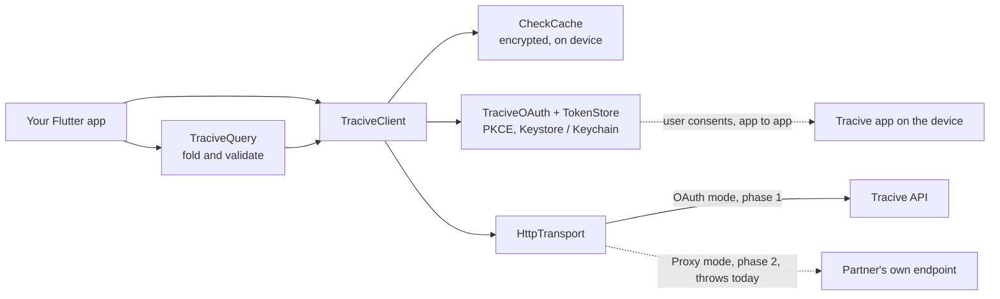
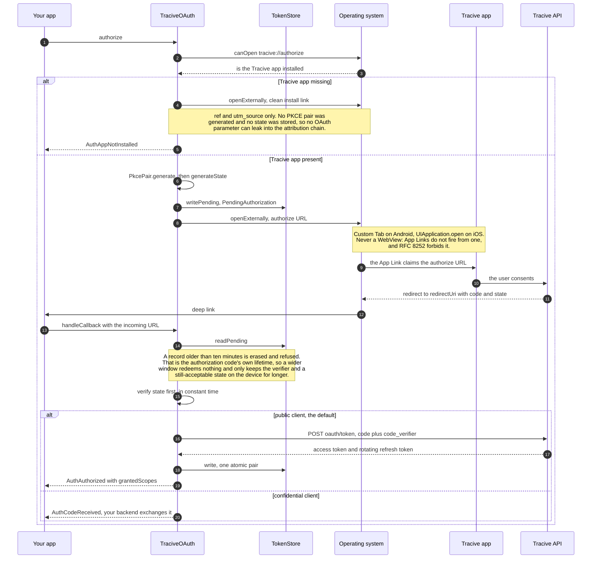
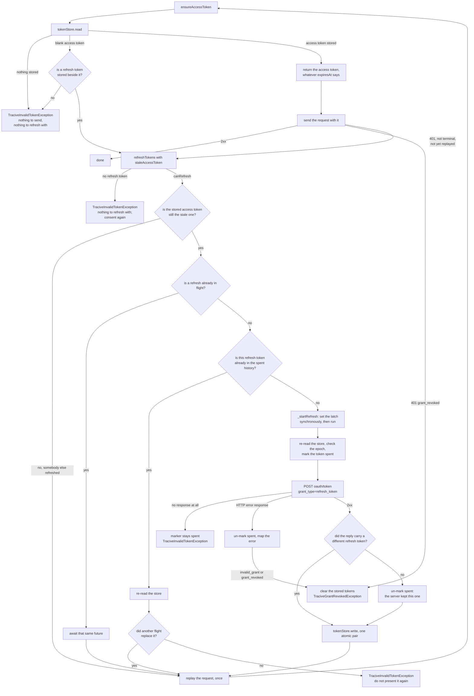
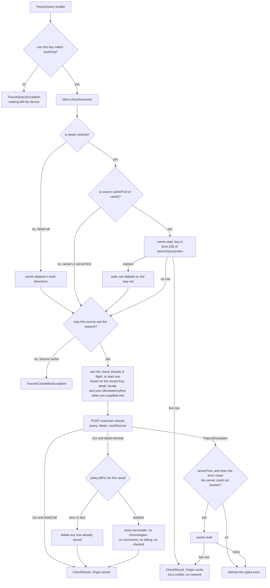
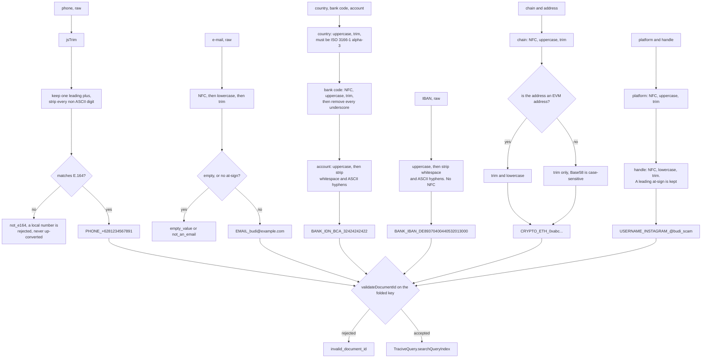

# Architecture

> Diagrams of what this SDK does and where each decision is made. Every arrow
> below is taken from the code in `lib/src/`; nothing here is aspirational.
>
> **The backend Open API is not live yet.** The shapes below are the frozen
> contract this SDK is built against, and no test in this repository reaches a
> network. See the README before you plan a launch around it.

The other documents cover the same ground in prose and go further on the
details: [`integration.md`](integration.md), [`oauth.md`](oauth.md),
[`caching.md`](caching.md), [`proxy-contract.md`](proxy-contract.md).

---

## A. Where the SDK sits

Your app talks to `TraciveClient`. `TraciveClient` owns four collaborators, and
each is a seam you can replace in a test: the query builders that fold input
into a lookup key, the local `CheckCache`, the `TraciveOAuth` flow with its
`TokenStore`, and the `HttpTransport` that every byte leaves through.

Two things the picture is making explicit:

- **There is no API key on any of those arrows, in any mode.** Authentication is
  OAuth 2.0 with PKCE, so nothing long-lived and secret ships in your binary.
  `TraciveMode` has no API-key parameter and is not going to grow one.
- **Proxy mode is a type, not a behaviour.** `TraciveMode.proxy(...)` compiles
  today and every call in that mode throws
  `TraciveNotImplementedException('Proxy mode arrives in phase 2')` before
  touching anything — see [`proxy-contract.md`](proxy-contract.md). In that
  mode `TraciveClient.oauth` is `null`, because there is no flow to build.

Everything that leaves the device in OAuth mode is resolved against
`TraciveEnvironment.baseUrl`: `POST scammer-checks`, `GET credits` and
`GET profile` for the API itself, and `oauth/authorize`, `oauth/token` and
`oauth/revoke` for the flow below.

---

## B. Authorization: authorization code with PKCE, S256

`authorize()` and `handleCallback()` are deliberately two calls rather than one
awaitable. The answer comes back minutes later as an App Link into your app,
possibly after Android has collected the process — which is why the PKCE
verifier is persisted through `TokenStore.writePending` *before* the URL is
opened, not held in a field.

What the ordering buys, in the order it appears:

1. **The presence probe runs before anything is generated.** It probes the
   custom scheme `tracive://authorize`, not the `https` authorize URL — a
   browser is always installed, so an `https` probe always answers `true`. The
   probe needs a manifest declaration on both platforms or it answers `false`
   for everyone; see [`oauth.md` § Platform setup](oauth.md#platform-setup).
2. **The challenge is always `S256`.** `code_challenge_method` is not a
   parameter of `buildAuthorizeUrl`, because it is not a decision. `plain` is
   not implemented anywhere in this package.
3. **`state` is checked before `error` and `code` are even read.** A redirect
   this SDK did not start is a redirect from somebody else, and nothing in it is
   worth interpreting. A mismatch yields `TraciveStateMismatchException` and
   deliberately does *not* clear the pending record, so a stray redirect cannot
   cancel the flow the user is genuinely in.
4. **A confidential client stops at the code.** `AuthCodeReceived` carries the
   code, the verifier and the redirect URI to your backend, which holds the
   `client_secret`. On that path this SDK never sees a token.

---

## C. Token lifecycle

Every authorized request starts with `ensureAccessToken()`, which hands over the
stored access token **without consulting the expiry**. A token the SDK holds is
refreshed when the server says so — any non-terminal `401` — and at no other
moment.
The one refresh that does not wait for a rejection is the repair of a stored
grant whose access token is blank: there is no token to send, so there is no
rejection to wait for. A *rotating* refresh token is single-use, so presenting
one twice is what the server's reuse detection looks for, and it answers by
revoking the whole grant. Four guards keep that from happening, and the diagram
is mostly those four guards.

**The blank-access-token branch** is the one entry into that chain where no
request has been sent yet, so what follows a successful refresh there is the
first send rather than a replay; everything between the two, guards included, is
the same. It lives in `ensureAccessToken()` rather than on the 401 path because
nothing on the 401 path could recover it: `Bearer ` is answered `invalid_token`,
which is the one 401 code that is terminal without a teardown — no refresh, and
the diagram's refresh deliberately excludes it. Such a record therefore never healed
itself; it failed on every call, and it failed by demanding a consent that was
not needed. With no refresh token stored beside the blank one there is nothing
to spend, and the same `TraciveInvalidTokenException` is thrown as for an empty
store.

**Why one mechanism and not two.** Refreshing ahead of `expiresAt` was tried and
removed. The reactive path is mandatory whatever else is true — a token can be
revoked, and a token can expire between the check and the send — so a pre-check
could never replace it, only run in front of it. Two mechanisms for one job, and
the redundant one hid bugs in the mandatory one: the pre-check always won first,
so the 401 path was the one that hardly ever ran. It was also comparing against
the *device's* clock, which this SDK does not own: a phone running ten minutes
fast refreshed on every call, and with rotating refresh tokens every rotation is
another chance to trip reuse detection. The price of dropping it is one wasted
round trip per token lifetime, single-flighted so one caller pays it, and it is
not billed — authentication precedes billing, and an unusable bearer token is
answered with a 401 rather than with a check. `expiresAt` is still stored, for a
caller who wants to look; see `doc/oauth.md`.

The four guards, and why none of them is redundant:

1. **The latch** (`_refreshInFlight`). N concurrent 401s produce one token
   request; everybody else awaits the same future. It is set synchronously,
   before the first `await` inside the flight can yield.
2. **The stale-token check.** A 401 that arrives *after* another request already
   refreshed would otherwise start a second, pointless refresh. Passing the
   token the failed request actually used lets this method notice the store has
   moved on and hand back what is there.
3. **The spent history** (`_spentRefreshTokens`). The latch leaves one real gap:
   a store read that *begins* before another flight writes and *completes* after
   that flight cleared the latch returns a snapshot whose refresh token has
   already been spent. Guard 2 does not catch it, because the stale snapshot
   still carries the very access token the caller is reporting as stale. So the
   guard is on the token's identity, not on timing. Please do not simplify it
   out.
4. **The flight's own store re-read.** A flight never sends the snapshot it was
   started from; it re-reads and sends whatever is live. That is what makes
   guard 3's bounded memory an optimisation rather than a security boundary — a
   snapshot too old to be recognised costs one redundant refresh, never a reuse.

Three asymmetries in the outcome handling are worth stating, because they look
inconsistent until you see what each is protecting:

- **An HTTP error response un-marks the token as spent; no response at all does
  not.** A token endpoint that answers with an error has issued no tokens
  (RFC 6749 §5.2), so the refresh token was not consumed and one 500 must not
  end the grant. A socket timeout is indistinguishable from a success whose
  reply was lost, so the marker stays and the user re-authorizes.
- **A 2xx un-marks the token too, if it is the token that came back.** Rotation
  is not something a token endpoint owes its client: RFC 6749 §6 permits
  re-issuing the same refresh token, and permits omitting `refresh_token`
  altogether to mean "keep the one you have", which this SDK honours by carrying
  the stored value forward. Either way the token now in the store is the string
  the flight marked spent, and leaving the marker on would refuse the *next*
  refresh locally for the life of the process — a client-side revocation caused
  by the guard against a server-side one. The comparison against the token that
  went out is what keeps a genuinely rotated-away token marked, which matters
  because the store may still be holding it: a `write` that refuses leaves
  exactly that.
- **Sign-out wins over anything already on the wire.** `signOut()` discards the
  local credentials *first* and calls `oauth/revoke` best-effort afterwards.
  Every path that is about to write tokens captured `_credentialEpoch` before
  its network call and compares it after, so a response that lands post-sign-out
  is discarded rather than refilling the store the user just emptied.

The 401 branches at the top of the diagram are `TraciveClient._sendAuthorized`,
which is where the whole strategy now lives: a non-terminal 401 triggers one
refresh and one replay. The replay is the identical request and carries an
`Idempotency-Key` — the client attaches one even when the caller supplied none —
so a first attempt that *was* billed can be collapsed server-side rather than
charged twice. It does not consume the retry budget, being a re-authentication
rather than a retry of a failed check. Meanwhile
`grant_revoked` clears the tokens and stops. `grant_revoked` is never retried;
retrying with a dead refresh token is exactly the pattern reuse detection
punishes, and `invalid_token` is terminal too — a credential the server calls
unusable is not made usable by minting another. A *second* 401 gives up rather
than looping.

---

## D. What one check actually does

The order below is the order in `TraciveClient.checkScammer`, and every branch
in it exists because **a miss is billed**.

That is also why a latch sits in front of the request. Two checks for the same
record key, detail and locale — a double-tapped button, or the same number
appearing twice in a list — collapse into one request and one bill. Your own
`idempotencyKey` is part of the latch key, so two callers who deliberately keyed
themselves apart stay apart; a caller who passes no key changes nothing. The
latch covers the network call; each caller writes the answer to its own cache
afterwards, which stores the same row twice and bills once.

### Which responses are not cached, and why

| Not cached | Why |
|---|---|
| Anything from a `detail: Detail.full` call | The cache key is the query alone. A full-detail answer carries `disclaimer` and `tags` in the requested language, so storing it would serve an Indonesian disclaimer to an English `detail: minimal` caller — in the one string this SDK asks every integrator to put on screen. Reading one is unsound for a plainer reason: a cached row has no chronologies and no comments, so it would silently answer with less than was asked for. |
| A response whose `cacheTtlSeconds` is zero or negative | The fleet-wide invalidation lever. It does more than skip the write — it **deletes** whatever row is already stored, because leaving the stale answer in place is the exact situation the lever exists for. |
| `topChronologies` and `comments`, within a cached row | `detail = full` content, and the most sensitive part of the response. `CheckResult.cacheable()` drops them. |
| `billing` and `checkId`, within a cached row | Single-use. A cache hit charged nothing and was assigned no id, so replaying either would misreport spend. |
| Every response, when `CachePolicy.enabled` is false | `CheckCache.disabled()` and `CachePolicy.disabled` exist for callers who must have a live answer every time. Every check then costs a credit. |

Three more properties that the diagram implies but does not spell out:

- **`Source.server` still writes.** It never *reads* the cache, but a successful
  minimal response is stored, so the next `cacheFirst` caller gets it free.
- **A broken cache degrades to a miss.** `read` and `write` never throw; the
  error is left in `CheckCache.lastStoreError`. Watch that value — a cache that
  quietly stopped working does not break anything, it just means every check
  from that device now costs a credit. (`remove`, `clear` and `prune` *do*
  throw, deliberately: a delete that quietly did nothing is worse than a miss.)
- **Retrying a check needs an `Idempotency-Key`.** `RetryPolicy` is only
  consulted when the caller promised the request is safe to repeat — a GET, or
  a POST carrying that header. Without one, a 5xx or a timeout surfaces on the
  first attempt rather than risking a double charge. 429 is never auto-retried;
  the server said how long to wait, on
  `TraciveRateLimitedException.retryAfter`.

---

## E. Folding an identifier into the lookup key

`TraciveQuery` turns a raw, human-typed identifier into the exact string the
backend indexes, and exposes it as `searchQueryIndex`. Folding client-side is
not an optimisation: that same folded string is what the local cache key is
derived from, so an unfolded key would split one entity across several cache
entries and every extra entry is a paid round trip.

Every rejection above is a `TraciveQueryException` carrying a stable,
cross-SDK `reason` string, and it is thrown **before any network call**. The
empty-field cases each name their own field — `empty_bank_code`,
`empty_account_id`, `empty_chain`, `empty_address`, `empty_platform`,
`empty_handle` — so the message can go next to the right input.

Three points the boxes compress:

- **Order is part of the contract, not an implementation choice.** E-mail and
  handle fold NFC, then lowercase, then trim; every code field (platform, chain,
  bank code) folds NFC, then uppercase, then trim; a bank account or IBAN
  uppercases *before* stripping, with no separate trim. Reordering changes the
  output on edge inputs, and a different output is a different key.
- **`jsTrim`, `jsToUpperCase` and `jsToLowerCase` are not Dart's.** The backend
  folds with JavaScript string semantics, so this SDK reimplements them: JS
  `trim()` strips exactly 25 code points (including U+FEFF, which Dart's `trim`
  leaves alone), and `\D` is ASCII-only, so Arabic-Indic digits are stripped
  rather than converted. NFC is applied to e-mails, handles and code fields, and
  **not** to bank account ids, crypto addresses or phone numbers.
- **NFC comes from an injectable normalizer, and the default is the full one.**
  Dart's core library has no NFC, so the SDK ships two implementations behind
  one seam. `UnormNormalizer` — full Unicode NFC — is what folds every query
  unless a host app deliberately replaces it, which is what keeps this SDK's
  keys identical to the three that get NFC from their platforms.
  `DefaultNormalizer` is the dependency-free opt-out: exact for ASCII, Latin,
  Greek, Cyrillic, Hangul and any already-decomposed input, and divergent from
  full NFC on 565 BMP code points fed raw. See
  [`integration.md` § Unicode normalisation](integration.md#unicode-normalisation).

`test/fixtures/query-grammar-vectors.json` pins all of this. It is vendored
byte-identically into every Tracive SDK repository and generated by executing
the API's own normalizer, so if an SDK disagrees with a vector, the SDK is
wrong. `test/query_grammar_test.dart` asserts every vector, which is what turns
a fold that drifts into a failed build here rather than a billed miss in
production. Do not edit that file to make a test pass.
